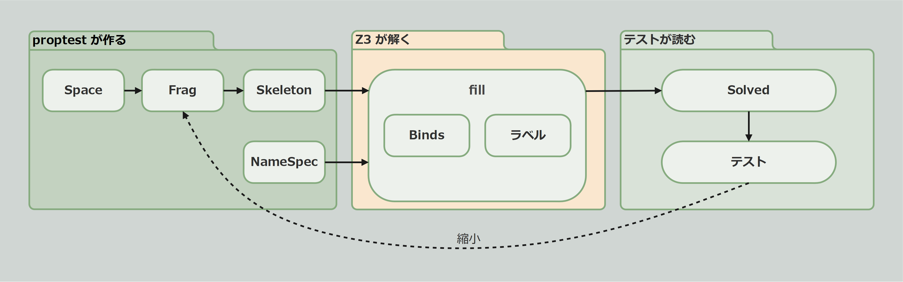

# 機能ガイド

この章では、proptest-z3 の機能を項目ごとに紹介します。

テストが失敗すると、proptest が構造・ヒント・項目を小さくし、Z3 がもう一度解き直します(縮小)。

| 節 | 内容 |
| --- | --- |
| [Space と穴](./space.md) | 名前空間と、名前が入る穴。穴の役割とヒント |
| [Frag と Skeleton](./frag.md) | 穴を並べて入力の構造を作る。ステップとスコープ |
| [NameSpec と Names](./names.md) | 穴に入る名前の候補 |
| [Binds と規則](./binds.md) | 名前どうしの関係を制約として書く |
| [ラベル](./labels.md) | 壊した場所の記録と、生成された入力の分類 |
| [fill と Solved](./fill.md) | proptest に渡す。解き方と、生成された入力の読み方 |

例には、[Getting Started](../getting_started.md) の小さな言語を使用します。各節では、説明に必要な文を追加しながら機能を紹介します。例で使用する関数などの実装は、[tests/lang.rs](https://github.com/asobininn/z3-toolkit/blob/main/crates/proptest-z3/tests/lang.rs) を基に、一部を簡略化しています。

| 文 | 意味 | 登場する節 |
| --- | --- | --- |
| `let x` | x を定義する | Getting Started |
| `let x = y` | y を使ってから x を定義する | Getting Started |
| `print x` | x を使う | Getting Started |
| `del x` | x を削除する。以降 x は使えない | Space と穴 |
| `{ .. }` | ブロック。中で定義した名前は外から見えない | Frag と Skeleton |
| `fn f` / `call f` | 関数 f を定義する / 呼ぶ | Space と穴 |
