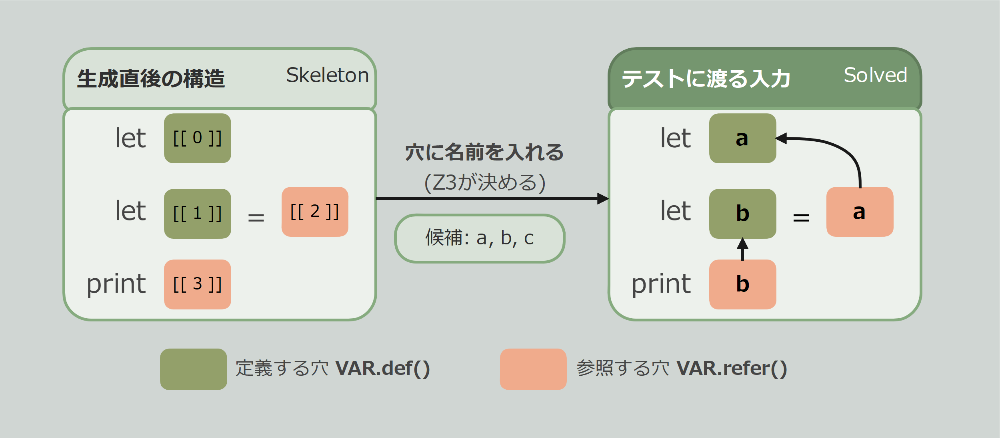

# Getting Started

この章では、小さな言語の名前解決器を例に、正常系と異常系のテストを1本ずつ書きます。

## 準備

```toml
[dev-dependencies]
proptest = "1"
proptest-z3 = "0.1"
```

Z3 のライブラリが必要です。入れ方については [z3 クレートのREADME](https://github.com/prove-rs/z3.rs/blob/master/z3/README.md) を参照してください。

## テストする対象

1行に1文の、小さな言語を考えます。

| 文 | 意味 |
| --- | --- |
| `let x` | x を定義する |
| `let x = y` | y を使ってから x を定義する |
| `print x` | x を使う |

テストする対象は、この言語の名前解決器です。未定義の名前を参照した位置を返します。

```rust
fn undefined_refs(source: &str) -> Vec<usize> {
    let offset = |word: &str| word.as_ptr() as usize - source.as_ptr() as usize;
    let mut defined = HashSet::new();
    let mut errors = vec![];
    for line in source.lines() {
        match line.split_whitespace().collect::<Vec<_>>()[..] {
            ["let", x] => {
                defined.insert(x);
            }
            ["let", x, "=", y] => {
                if !defined.contains(y) {
                    errors.push(offset(y));
                }
                defined.insert(x);
            }
            ["print", y] => {
                if !defined.contains(y) {
                    errors.push(offset(y));
                }
            }
            ref other => panic!("unexpected line: {other:?}"),
        }
    }
    errors
}
```

## 1. 骨格を書く

名前を書く場所に、文字列の代わりに「穴」を置きます。穴は「後で名前が入る空欄」です。どの穴にどの名前が入るかは、制約をもとに Z3 が決定します。



`VAR` は**名前空間**(`Space`)です。変数と関数のように、互いに独立した名前の集まりごとに1つ作ります。

- `VAR.def()`: 名前を定義する穴
- `VAR.refer()`: 名前を参照する穴

```rust
use proptest::prelude::*;
use proptest_z3::prelude::*;

const VAR: Space = Space::new("var");

fn program() -> impl Strategy<Value = Skeleton> {
    prop::collection::vec(stmt(), 1..8)
        .prop_map(|stmts| Skeleton::steps(stmts.into_iter().map(|s| frag![s, "\n"])))
}

fn stmt() -> impl Strategy<Value = Frag> {
    prop_oneof![
        VAR.def().prop_map(|x| frag!["let ", x]),
        (VAR.def(), VAR.refer()).prop_map(|(x, y)| frag!["let ", x, " = ", y]),
        VAR.refer().prop_map(|y| frag!["print ", y]),
    ]
}
```

`frag!` は、文字列を穴を並べて1つの断片(`Frag`)にします。`Skeleton::steps` は、要素を1つずつステップとして区切ります。言語の「文」に当たる単位で区切ってください。

## 2. 名前の候補を決める

穴に入る名前は、ユーザーが用意した候補の中から選ばれます。`NameSpec` は、名前空間ごとに候補の作り方を決めるものです。

```rust
fn names() -> NameSpec {
    // [a-c] に合う、互いに異なる名前を3個
    NameSpec::new().space(VAR, "[a-c]", 3)
}
```

## 3. 正常系: 定義済みの名前だけ使用する

`.fill(names, rule)` で、穴を埋めた入力の Strategy になります。`rule` は、守らせたい関係を返す関数です。

`bound(VAR)` は「`VAR` のすべての参照の穴に、それより前の文で定義された名前が入る」という制約です。

```rust
proptest! {
    #[test]
    fn defined_names_resolve(s in program().fill(names(), |binds| bound(binds, VAR))) {
        prop_assert_eq!(undefined_refs(&s.text), vec![], "{:?}", s);
    }
}
```

## 4. 異常系: 1箇所だけ未定義にする

正常系の制約を反転させると異常系になります。`!visible(binds, i)` は「参照 `i` が、見えていない名前を指す」です。それがちょうど1つあるように書きます。

```rust
#[derive(Debug, Clone, Copy, PartialEq)]
struct Undefined;

proptest! {
    #[test]
    fn undefined_name_is_reported_where_it_is(s in program().fill(names(), |binds| constraint!(
        exactly(1) {for i in binds.refs(VAR) {
            binds.mark(i, Undefined, !visible(binds, i))
        }},
    ))) {
        eprintln!("{}", s.text);
        let [(hole, Undefined)] = s.marks::<Undefined>()[..] else {panic!("{s:?}")};
        prop_assert_eq!(undefined_refs(&s.text), vec![s.span(hole).start], "{:?}", s);
    }
}
```

`mark` は穴に印をつけるためのものです。`binds.mark(i, Undefined, 条件)` と書くと、生成された入力でその条件が成り立っていれば、穴 `i` に `Undefined` という印が付きます。

## 5. バグを見つける

名前解決器によくあるバグを入れてみます。`let x = y` で、右辺を調べる前に左辺を定義してしまうバグです。

```rust
["let", x, "=", y] => {
    defined.insert(x);
    if !defined.contains(y) {
        errors.push(offset(y));
    }
}
```

テストを実行すると、異常系が失敗し、入力が縮められます。

```text
test undefined_name_is_reported_where_it_is ... FAILED
test defined_names_resolve ... ok

minimal failing input: s = Solved{
  0| let b
  1| let a = a
 marks: Undefined @ 14..15 `a`
}
```

2行目の右辺の a は未定義のはずですが、名前解決器はエラーを報告しませんでした。

正常系のテストが通っていても、本来エラーにすべき入力を受け入れてしまうバグは残り得ます。異常系の入力も生成することで、こうしたバグを検出できます。

> **縮小について**: 反例に、バグと関係のない let b が残っています。proptest-z3 の縮小は、名前の関係を保ちながら入力を小さくしますが、これ以上縮まなくなるまで繰り返すことはしません。原因が読み取れる大きさまで縮めば十分という方針で、その分テストの実行が速く終わります。残った行も、制約を満たす正しい入力の一部です。
