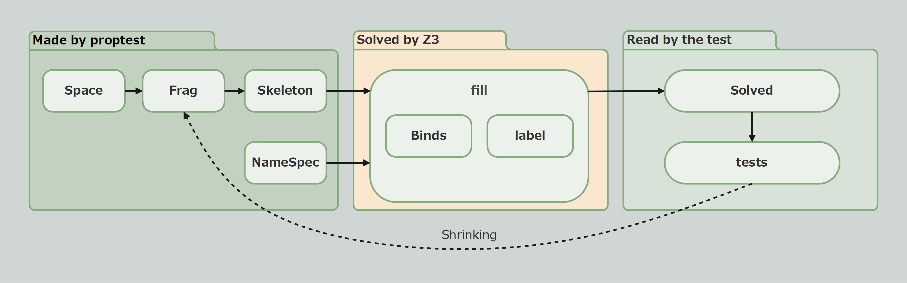

# Feature Guide

This chapter introduces proptest-z3 feature by feature.

When a test fails, proptest shrinks the structure, hints, and candidate set, and Z3 solves the constraints again. This process is called **shrinking**.

| Section | What it covers |
| --- | --- |
| [Spaces and Holes](./space.md) | Namespaces, holes, their roles, and hints |
| [Frag and Skeleton](./frag.md) | Building input structure from holes; steps and scopes |
| [NameSpec and Names](./names.md) | Candidate names that can fill holes |
| [Binds and Rules](./binds.md) | Expressing relationships between names as constraints |
| [Labels](./labels.md) | Recording broken locations and classifying generated inputs |
| [fill and Solved](./fill.md) | Passing a Strategy to proptest, choosing a solving mode, and reading generated inputs |

The examples use the small language from [Getting Started](../getting_started.md). Each section introduces additional statements as needed. Helper implementations are simplified from [`tests/lang.rs`](https://github.com/asobininn/z3-toolkit/blob/main/crates/proptest-z3/tests/lang.rs).

| Statement | Meaning | Introduced in |
| --- | --- | --- |
| `let x` | Define `x` | Getting Started |
| `let x = y` | Use `y`, then define `x` | Getting Started |
| `print x` | Use `x` | Getting Started |
| `del x` | Delete `x`; it cannot be used afterward | Spaces and Holes |
| `fn f { .. }` / `call f` | Define and call a function | Spaces and Holes |
| `{ .. }` | A lexical scope | Frag and Skeleton |
| `[ .. ]` | A boundary, such as a closure body | Frag and Skeleton |
