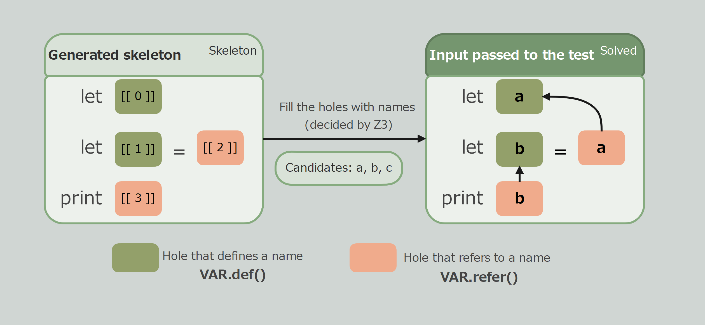

# Getting Started

In this chapter, we will write one normal-case test and one error-case test for a name resolver for a small language.

## Setup

```toml
[dev-dependencies]
proptest = "1"
proptest-z3 = "0.1"
```

The Z3 library is also required. For installation instructions, see the [z3 crate README](https://github.com/prove-rs/z3.rs/blob/master/z3/README.md).

## The system under test

Consider a small language with one statement per line.

| Statement | Meaning |
| --- | --- |
| `let x` | Define `x` |
| `let x = y` | Use `y`, then define `x` |
| `print x` | Use `x` |

The system under test is this language's name resolver. It returns the positions where undefined names are referenced.

```rust
fn undefined_refs(source: &str) -> Vec<usize> {
    let offset = |word: &str| word.as_ptr() as usize - source.as_ptr() as usize;
    let mut defined = HashSet::new();
    let mut errors = vec![];
    for line in source.lines() {
        match line.split_whitespace().collect::<Vec<_>>()[..] {
            ["let", x] => {
                defined.insert(x);
            }
            ["let", x, "=", y] => {
                if !defined.contains(y) {
                    errors.push(offset(y));
                }
                defined.insert(x);
            }
            ["print", x] => {
                if !defined.contains(x) {
                    errors.push(offset(x));
                }
            }
            _ => unreachable!(),
        }
    }
    errors
}
```

This implementation is intentionally simple: definitions become visible after their statement is processed.

## Build a Strategy for valid programs

We will build a `program()` Strategy that creates the shape of the input, then use constraints to ensure that every reference resolves to a visible definition.



```rust
use proptest::prelude::*;
use proptest_z3::prelude::*;

const VAR: Space = Space::new("var");

fn program() -> impl Strategy<Value = Skeleton> {
    prop::collection::vec(
        prop_oneof![
            Just(VAR.def()).boxed(),
            (VAR.def(), VAR.refer())
                .prop_map(|(x, y)| frag!("let ", x, " = ", y))
                .boxed(),
            VAR.refer().prop_map(|x| frag!("print ", x)).boxed(),
        ],
        1..8,
    )
    .prop_map(Skeleton::steps)
}

fn names() -> NameSpec {
    NameSpec::new().space(VAR, "[a-c]", 3)
}
```

The Strategy describes the possible statement shapes. `fill` assigns names to the holes while satisfying the rule.

```rust
proptest! {
    #[test]
    fn defined_names_resolve(
        s in program().fill(names(), |binds| bound(binds, VAR))
    ) {
        prop_assert_eq!(undefined_refs(&s.text), vec![], "{:?}", s);
    }
}
```

## Generate an invalid input deliberately

A random valid program rarely contains an undefined reference. To test the error path, require exactly one reference to be invisible and mark that location.

```rust
#[derive(Debug, Clone, Copy, PartialEq)]
enum Bug {
    Unbound,
}

proptest! {
    #[test]
    fn undefined_names_are_reported(
        s in program().fill(names(), |binds| constraint!(
            exactly(1) {
                for i in binds.refs(VAR) {
                    binds.mark(i, Bug::Unbound, !visible(binds, i))
                }
            },
        ))
    ) {
        let [(hole, Bug::Unbound)] = s.marks::<Bug>()[..] else {
            panic!("expected exactly one marked hole");
        };
        let span = s.span(hole);
        prop_assert_eq!(undefined_refs(&s.text), vec![span.start], "{:?}", s);
    }
}
```

The constraint asks Z3 to generate an input with exactly one invisible reference. `mark` records which hole violates the rule, and `Solved::span` maps that hole to a byte range in the generated text.

This example is deliberately small. The [Feature Guide](./feature_guide/SUMMARY.md) explains how to represent scopes, name candidates, and more complex relationships.
